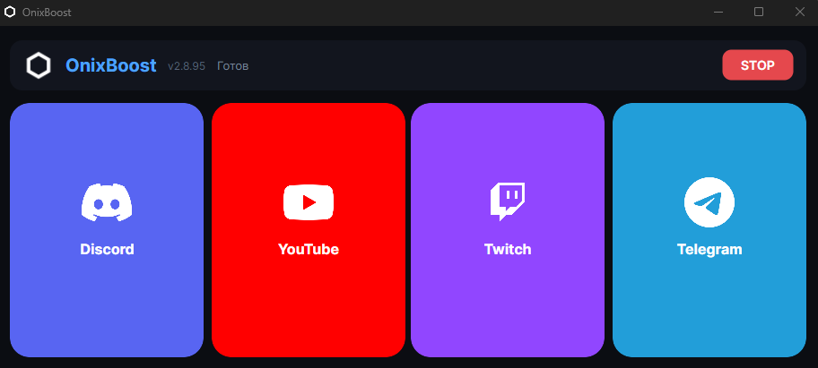

<div align="center">


# OnixBoost

**Windows-менеджер сетевых маршрутов для отдельных приложений.**  
Включайте Discord, YouTube, Twitch или Telegram по отдельности — без смены маршрутизации всей системы.

<p>
  
  &nbsp;&nbsp;&nbsp;&nbsp;
  
  &nbsp;&nbsp;&nbsp;&nbsp;
  
  &nbsp;&nbsp;&nbsp;&nbsp;
  
</p>

<p>
  <a href="https://github.com/OnixV-1/OnixBoost/releases/latest"></a>
  <a href="https://github.com/OnixV-1/OnixBoost/releases"></a>
  <a href="https://github.com/OnixV-1/OnixBoost/commits/main"></a>
  
  <a href="LICENSE"></a>
</p>

<p>
  <a href="https://github.com/OnixV-1/OnixBoost/releases/latest/download/OnixBoost-Setup.exe"></a>
</p>

Каждая карточка — отдельный профиль подключения. Несколько карточек можно держать включёнными одновременно.

<br/>


</div>

> [!CAUTION]
> ### Официальные сборки
> Скачивайте **только** с [Releases](https://github.com/OnixV-1/OnixBoost/releases/latest).  
> Сторонние «сборки» и зеркала мы не проверяем. Сверьте SHA-256 из описания релиза ([инструкция](#проверка-установщика)).

> [!WARNING]
> ### WinDivert
> Для карточки Discord загружается драйвер [WinDivert](https://reqrypt.org/windivert.html) ([LGPLv3](THIRD-PARTY-NOTICES.md)) — нужны права администратора.  
> Антивирусы иногда помечают его как *RiskTool / PUA*. Подробнее: [Безопасность и приватность](#безопасность-и-приватность).

---

## Содержание

- [Что это](#что-это)
- [Как это работает](#как-это-работает)
- [Что умеет](#что-умеет)
- [Безопасность и приватность](#безопасность-и-приватность)
- [Проверка установщика](#проверка-установщика)
- [Быстрый старт](#быстрый-старт)
- [Интерфейс](#интерфейс)
- [Обновления](#обновления)
- [Если не работает](#если-не-работает)
- [Частые вопросы](#частые-вопросы)
- [Исходный код](#исходный-код)
- [Лицензия](#лицензия)
- [Обратная связь](#обратная-связь)
- [Требования](#требования)

---

## Что это

**OnixBoost** — Windows-приложение от [OnixV](https://t.me/Onix_Vbot) для управления сетевыми маршрутами выбранных приложений.

Это не системный VPN: включается только трафик сервисов, которые вы выбрали карточками.  
Остальной трафик ПК продолжает использовать обычное подключение.

Условия использования и вклад в код — в [LICENSE](LICENSE) и [CONTRIBUTING.md](CONTRIBUTING.md).

---

## Как это работает

OnixBoost создаёт независимые правила маршрутизации для выбранных приложений.  
Включение карточки влияет только на трафик соответствующего сервиса; системный маршрут по умолчанию и трафик других программ не изменяются.

| Карточка | Технически |
|----------|------------|
| **Discord** | Профиль маршрутизации на основе [WinDivert](https://reqrypt.org/windivert.html) и **winws**: обрабатываются пакеты по списку доменов Discord |
| **YouTube / Twitch** | Локальный mixed-прокси и системный **PAC**: в Chrome / Edge маршрутизируются только домены выбранного сервиса |
| **Telegram** | Отдельный профиль туннеля для доменов Telegram, независимо от остальных карточек |

- Discord, YouTube, Twitch и Telegram настраиваются **отдельно**
- **STOP** сбрасывает активные правила и возвращает стандартную конфигурацию сети

> **Термины:** **winws** — консольная утилита для применения правил обработки сетевых пакетов.  
> **PAC** — файл автоматической настройки прокси для браузера.  
> **Профиль / списки правил** — набор доменов и параметров, которые winws или прокси применяют к выбранной карточке.

Публичный исходник содержит клиент, UI и установщик. Серверные endpoint’ы и runtime-секреты не публикуются и **не входят** в публичную лицензию.

---

## Что умеет

| Сервис | Что делает |
|--------|------------|
| **Discord** | Маршрутизирует трафик Discord через выбранный профиль; чаты, голосовые каналы и демонстрация экрана работают в обычном клиенте |
| **YouTube** | Маршрутизирует трафик YouTube в Chrome / Edge через локальный прокси-профиль. После включения один раз перезапустите браузер |
| **Twitch** | Маршрутизирует трафик Twitch в Chrome / Edge через локальный прокси-профиль; можно держать вместе с YouTube |
| **Telegram** | Отдельный профиль для десктопа и веба Telegram |

Дополнительно: несколько карточек сразу · обновление кнопкой **Обновить** · **STOP** / выход из трея снимают активные правила.

---

## Безопасность и приватность

- Права администратора нужны для загрузки сетевого драйвера (WinDivert) и применения правил  
- WinDivert и прочие сторонние компоненты — [THIRD-PARTY-NOTICES.md](THIRD-PARTY-NOTICES.md)  
- OnixBoost **не читает** файлы, переписки, экран, буфер обмена или локальные данные приложений  
- При активном профиле могут обрабатываться **сетевые пакеты**, соответствующие правилам выбранной карточки  
- OnixBoost работает на уровне маршрутизации пакетов и прокси-правил  
- Приложение **не выполняет MITM-расшифровку** TLS/QUIC-трафика и **не сохраняет** его содержимое  

### Локальные логи

- Файл `onixboost.log` в каталоге установки: служебные сообщения (запуск профилей, ошибки, статус обновлений)  
- Логи **не предназначены** для записи URL страниц, cookies, паролей или текста сообщений  
- Удаление: закройте OnixBoost и удалите `onixboost.log` (при следующем запуске создастся заново)

### Служебные сетевые обращения

| Назначение | Куда | Учётные данные |
|------------|------|----------------|
| Обновления приложения | GitHub Releases / `version.json` этого репозитория | не отправляются |
| Списки IP Discord | публичные файлы на GitHub ([amnezia-discord-config](https://github.com/iamkuper/amnezia-discord-config)) | не отправляются |
| Списки правил winws | GitHub Releases проекта Flowseal | не отправляются |
| Проверка Online | прямые запросы к публичным endpoint’ам выбранного сервиса (например `discord.com`, `youtube.com`, `twitch.tv`) | не отправляются; **не** проксируются на серверы OnixBoost |

### Внешние списки и обновления

OnixBoost может загружать публичные списки хостов/IP и архивы правил из указанных выше источников.

**Текущие ограничения (честно):**

- Для списков Discord используется ветка upstream `main` (не pinned tag)  
- Для правил winws берётся **latest** release upstream (тег фиксируется только на момент загрузки, повторная синхронизация может подтянуть новый latest)  
- Отдельной проверки SHA-256 / подписи загруженных списков **пока нет**  
- Отдельной настройки «отключить автообновление списков» в UI **пока нет**  

Планируется: pinned-версии и проверка целостности перед применением. До этого относитесь к автообновлению списков как к доверию к указанным публичным репозиториям.

Уязвимости — по [SECURITY.md](SECURITY.md).

---

## Проверка установщика

Скачайте `Setup.exe` только из официального [Release](https://github.com/OnixV-1/OnixBoost/releases/latest) и сверьте SHA-256:

```powershell
Get-FileHash .\OnixBoost-Setup.exe -Algorithm SHA256
```

Актуальный хэш — в описании соответствующего GitHub Release.

---

## Быстрый старт

1. Скачайте **[Setup.exe](https://github.com/OnixV-1/OnixBoost/releases/latest/download/OnixBoost-Setup.exe)** из [Releases](https://github.com/OnixV-1/OnixBoost/releases/latest)  
2. Установите и запускайте **от администратора** (рекомендуемый путь: `C:\OnixBoost`)  
3. Нажмите карточку → дождитесь статуса **Online**  
4. Для YouTube / Twitch после включения один раз **перезапустите браузер**  
5. Повторный клик выключает карточку, **STOP** — снимает все активные правила  

---

## Интерфейс

<div align="center">
  
</div>

Четыре независимые карточки. Статус **Online** — профиль активен.

---

## Обновления

При запуске и в фоне проверяется новая версия (GitHub Releases). Если есть — кнопка **Обновить**.  
Актуальный установщик: [latest release](https://github.com/OnixV-1/OnixBoost/releases/latest).

---

## Если не работает

1. См. [Безопасность и приватность](#безопасность-и-приватность) (админ, WinDivert, антивирус)  
2. **STOP** → 5–10 секунд → снова карточка  
3. YouTube / Twitch: **Chrome или Edge**, перезапуск браузера после Online  
4. Discord: перезапуск клиента после Online (первая установка может долго качать обновление)  
5. Путь установки **латиницей** (`C:\OnixBoost`): профили winws используют относительные пути к драйверу и спискам — каталоги с не-ASCII символами на части систем дают сбои  
6. Переустановка с официального Setup + [проверка SHA-256](#проверка-установщика)  

---

## Частые вопросы

### Это VPN на весь ПК?
Нет. Изменяется маршрутизация только выбранных сервисов.

### Затронет ли YouTube / Twitch игры (Steam, CS2)?
Нет. Профили YouTube/Twitch не меняют системный маршрут по умолчанию для игр.

### Антивирус удаляет файлы
См. [Безопасность и приватность](#безопасность-и-приватность).

### После выключения странный интернет
**STOP** или выход из трея. Иначе — перезапуск сетевого адаптера или ПК.

### Почему не все конфиги в репозитории?
Клиент доступен для изучения (**source-available**). Серверные секреты не лицензированы для публикации — [LICENSE](LICENSE).

---

## Исходный код

Клиент и установщик: Avalonia / .NET 8.

| Папка | Содержимое |
|-------|------------|
| `OnixBoost/` | Приложение |
| `OnixBoost.Setup/` | Установщик |
| `assets/` | Логотипы, скриншот, демо |
| `LICENSE` | Условия использования |
| `THIRD-PARTY-NOTICES.md` | Сторонние компоненты |
| `SECURITY.md` | Уязвимости |
| `CONTRIBUTING.md` | Участие и PR |

```bash
dotnet publish OnixBoost/OnixBoost.csproj -c Release -r win-x64 --self-contained true
```

---

## Лицензия

Клиент и установщик OnixBoost доступны в режиме **source-available** по проприетарной лицензии OnixBoost.  
Полный текст: [LICENSE](LICENSE).

**Разрешено:**

- Личное использование официальных сборок  
- Изучение публичного исходного кода  
- Отправка изменений через Pull Request в этот репозиторий  
- Распространение только **неизменённых** официальных установщиков с указанием автора и ссылки на репозиторий  

**Запрещено:**

- Распространение изменённых, пересобранных или неполных версий  
- Использование кода в других продуктах без отдельного разрешения  
- Публикация серверных endpoint’ов, ключей, токенов и runtime-конфигураций  

Серверные endpoint’ы, ключи и runtime-секреты **не являются** частью публичной лицензии.  
ПО предоставляется «как есть», без гарантий.

Сторонние компоненты (включая WinDivert / LGPLv3): [THIRD-PARTY-NOTICES.md](THIRD-PARTY-NOTICES.md).

---

## Обратная связь

- Баги и идеи: [Issues](https://github.com/OnixV-1/OnixBoost/issues)  
- Участие в коде: [CONTRIBUTING.md](CONTRIBUTING.md)  
- Уязвимости: [SECURITY.md](SECURITY.md)  
- Связь с автором: [Telegram OnixV](https://t.me/Onix_Vbot)  

Нашли баг или хотите предложить функцию — откройте Issue.

---

## Требования

- Windows 10 / 11 (x64)  
- Права администратора  
- Интернет при первом запуске  
- Для YouTube / Twitch — браузер **Chrome** или **Edge**  
